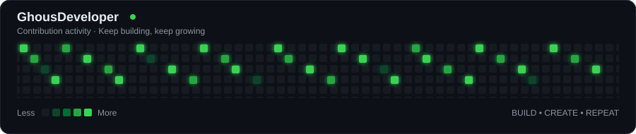

<h1 align="center">Hi 👋, I'm Ghulam Ghous Kalwar</h1>

<h3 align="center">
Full Stack Developer • AI Engineer • AI Automation Specialist
</h3>

  

  

---

## 💫 About Me

👋 Hi, I'm **Ghulam Ghous Kalwar**, a developer from Pakistan passionate about web development, artificial intelligence, and business automation.

- 💻 Building modern, responsive web applications.
- 🤖 Exploring Generative AI, LLMs, and AI Agents.
- ⚡ Creating automated workflows using n8n and APIs.
- 🚀 Developing AI-powered products and SaaS platforms.
- 🛠️ Working with React, Next.js, TypeScript, and modern backend technologies.
- 🌱 Continuously improving my coding, debugging, and software development skills.
- 🎯 Focused on building practical digital solutions for real-world problems.

**My mission:** Build useful software that combines modern web technology with the power of AI.

 

---

## 🌐 Connect With Me

  
  
  
  

---

## 💻 Tech Stack

### 🎨 Frontend Development

  

### ⚙️ Backend & APIs

  

### 🗄️ Databases & Backend Services

  

### 🤖 AI Engineering & Automation

  
  
  
  
  
  

### 🛠️ Tools & Platforms

  
  
  

---

## 🚀 Featured Projects

### 1. 🤖 Interview Mentor
AI-assisted teacher recruitment and assessment SaaS designed to help schools organize candidate screening, voice interviews, and classroom simulations.

### 2. ⚡ Ghous Solutions
A business outreach and lead management platform concept focused on organizing leads, follow-ups, email campaigns, and workflow automation.

### 3. 🌸 Naimas Perfume
A modern perfume e-commerce frontend built with React, TypeScript, Vite, and Tailwind CSS.

### 4. 🛒 Zero Bazar
A Pakistan-focused e-commerce project featuring product browsing, shopping cart, wishlist, and coupon functionality.

  

---

## 📊 GitHub Statistics

  
  

---

## 🔥 GitHub Contribution Streak

  

---

## 📈 Contribution Graph

  

---

## 📋 GitHub Profile Summary

  

  
  

---

## ✍️ Developer Quote

  

---

## 🤝 Let's Build Something Amazing

I'm interested in connecting with developers, AI enthusiasts, startups, and businesses to explore ideas and build useful digital products.

  
  

---

  
  

  <i>"Keep learning, keep building, and turn ideas into reality."</i>

  

